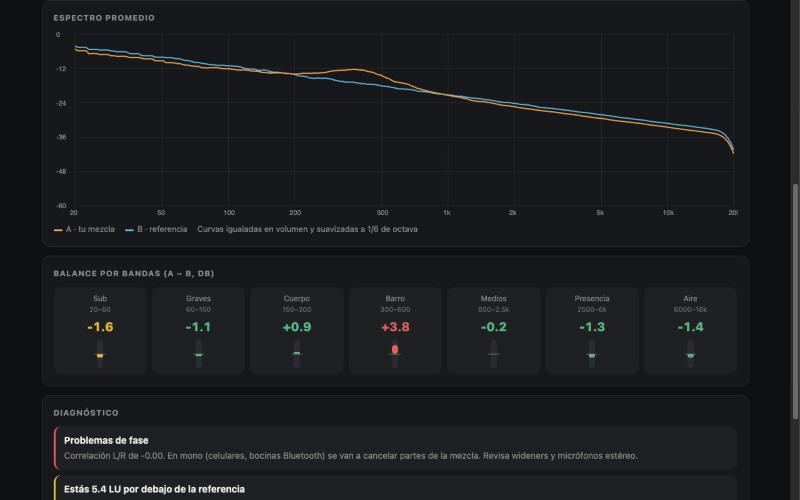
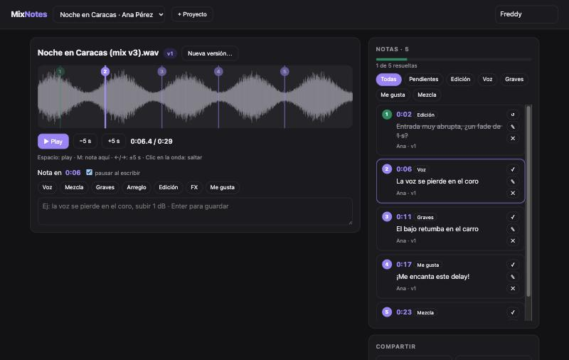
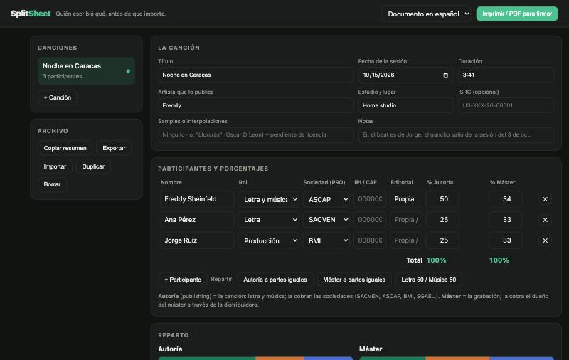
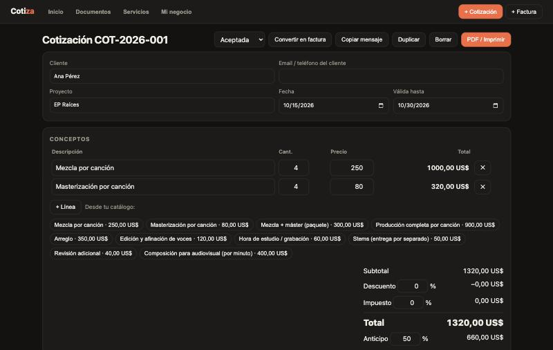
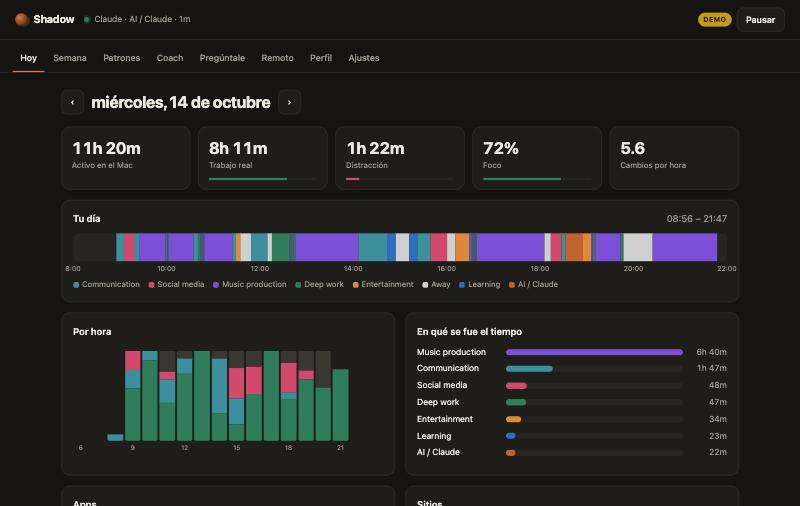

# Freddy Sheinfeld

Músico y productor. Hago apps con *vibe coding* (con Claude Code) para resolver problemas reales de mi trabajo: mezclar, producir, cobrar y organizarme.

## 🎚️ Music Apps

| | |
|---|---|
|  | **RefMatch**: tu mezcla contra la referencia, al mismo volumen. LUFS, true peak, espectro superpuesto, balance por bandas y diagnóstico (“hay barro en 300–600 Hz”).  **[▶ Pruébala](https://fsheinfeld.github.io/refmatch/)** |
|  | **MixNotes**: comentarios del cliente con el tiempo exacto, versiones, notas pegadas desde WhatsApp y marcadores para Cubase. Tiene además una versión con link para que el cliente comente desde su teléfono.  **[▶ Pruébala](https://fsheinfeld.github.io/mixnotes/)** |
|  | **SplitSheet**: porcentajes de autoría y máster, sociedades de gestión y acuerdo listo para firmar en español o inglés.  **[▶ Pruébala](https://fsheinfeld.github.io/splitsheet/)** |

## 💼 Office Apps

| | |
|---|---|
|  | **Cotiza**: cotizaciones y facturas para músicos. Catálogo de servicios, anticipos, PDF con tu marca y control de cobros.  **[▶ Pruébala](https://fsheinfeld.github.io/cotiza/)** |
|  | **Shadow** *(herramienta personal)*: un asistente que vive en mi Mac. Mide en qué se me va el tiempo, encuentra patrones, revisa el tono de mis emails antes de enviarlos y me da un debrief diario con Claude Opus 5.5. Python, SQLite, AppleScript y extensión de Chrome. |

## 🏠 Home & Other Apps

Próximamente.

---

El código fuente es privado y está **disponible bajo pedido**. Si quieres verlo o trabajar conmigo, escríbeme.

© 2026 Freddy Sheinfeld. Las apps web corren en tu navegador: tus archivos no salen de tu equipo.
